<!-- Banner animado (ASCII + halftone). Gere de novo com: python3 gerar_banner.py -->
<p align="center">
  
</p>

<!-- Frases digitando em verde neon (troque as linhas em "lines") -->
<p align="center">
  
</p>

<!-- Ondas verdes animadas como divisor -->


## `> whoami`
```text
nome     : SEU NOME
foco     : o que você faz
stack    : tecnologias que você usa
contato  : seu@email.com
```

## `> stack`
<p>
  
</p>

## `> stats`
<!-- Troque SEU_USUARIO pelo seu usuário do GitHub -->
<p>
  
  
</p>


