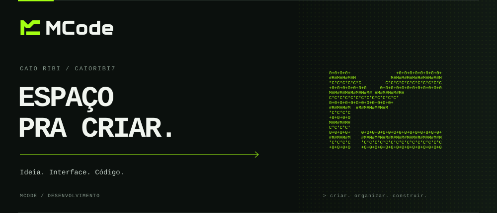

<p align="center">
  <a href="https://github.com/caioribi7">GitHub</a> &nbsp; / &nbsp;
  <a href="https://github.com/caioribi7/mcode-space">MCode Space</a> &nbsp; / &nbsp;
  <a href="mailto:mcode.contato@gmail.com">Contato MCode</a>
</p>

```text
> whoami
Caio Ribi / MCode
```

Desenvolvo interfaces e ferramentas para transformar ideias em projetos que funcionam.
Faço parte da **MCode**, onde design e desenvolvimento caminham juntos.

### O que estamos construindo

**[MCode Space](https://github.com/caioribi7/mcode-space)** — um ambiente desktop para organizar terminais, editar arquivos e cuidar dos projetos no mesmo lugar.

```text
mcode-space/
|-- workspace    arquivos, editor e terminais
|-- agents       Codex, Hermes, OpenCode e Claude
|-- equipe       financeiro e tarefas compartilhados
`-- contratos    preencher, conferir e gerar PDF
```

### No código

Ferramentas presentes nos projetos da MCode:

`JavaScript` · `HTML` · `CSS` · `Node.js` · `Electron` · `Supabase` · `Git`

---

<p align="center"><code>&gt; criar. organizar. construir.</code></p>
