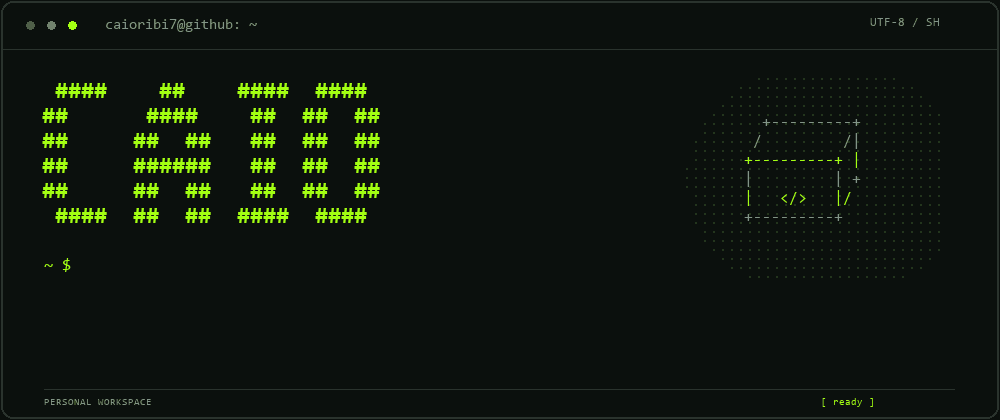

<p align="center">
  
</p>

```text
~ $ cat about.txt

Caio Ribi / @caioribi7
Interfaces, ferramentas e ideias que viram código.
```

```text
~ $ ls toolbox/

JavaScript   HTML       CSS
Node.js      Electron   Supabase
Git
```

<p align="center">
  <a href="https://github.com/caioribi7?tab=repositories">repositórios</a>
  &nbsp; / &nbsp;
  <a href="https://github.com/caioribi7?tab=stars">stars</a>
</p>

<p align="center"><code>build. break. learn. repeat.</code></p>
